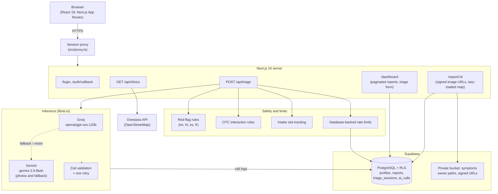

<div align="center">
  <h1>MedAI: AI Symptom Triage & Clinic Finder</h1>
  <p>A full-stack symptom triage web app built with Next.js 16, React 19, TypeScript, Supabase, Groq and Google Gemini.</p>

  <p>
    <a href="https://med-ai-mauve.vercel.app" target="_blank">
      
    </a>
  </p>

  <p>
    
    
    
    
    
    
    
    <a href="https://github.com/Nikky-SDE/MedAI/actions/workflows/ci.yml">
      
    </a>
  </p>
</div>

---

> [!IMPORTANT]
> **Disclaimer:** MedAI is an informational demo project. It is **not** a medical device, has **not** been clinically validated, and is **not** a substitute for professional medical advice, diagnosis, treatment or emergency services. If you think you are having a medical emergency, contact your local emergency number.

---

## Contents

- [Demo](#demo)
- [Architecture](#architecture)
- [Features](#features)
- [Design decisions](#design-decisions)
- [Evaluation](#evaluation)
- [Performance](#performance)
- [Security and privacy](#security-and-privacy)
- [Testing and CI](#testing-and-ci)
- [Tech stack](#tech-stack)
- [Local setup](#local-setup)
- [Known limitations](#known-limitations)
- [Roadmap](#roadmap)
- [License](#license)

---

## Demo

<!-- Add a 30-second screen recording at docs/demo.gif, then replace the block below with:  -->
```text
User describes symptoms -> server-controlled triage (up to 3 turns) -> structured report + nearby clinic map
```

---

## Architecture



---

## Features

- **Server-owned triage loop.** The intake conversation is stored in `triage_sessions` and controlled by the server. The client sends only `{ sessionId, message }`, so it cannot tamper with the transcript or the loop, and each user's LLM usage is capped.
- **Deterministic red-flag detection.** Emergency checks run before any LLM call in English, Hindi, Spanish and French (chest pain, stroke signs, severe bleeding, breathing difficulty, anaphylaxis, suicidal ideation). A match shows emergency guidance immediately, without waiting for a model.
- **Curated OTC interaction rules.** A small rule set checks reported medications, history, age and pregnancy against known high-risk combinations before OTC suggestions are shown. Coverage is intentionally limited (see [Known limitations](#known-limitations)).
- **Groq with Gemini fallback.** Text triage uses Groq (`openai/gpt-oss-120b`). Gemini (`gemini-2.5-flash`) analyzes symptom photos and serves as the fallback. Outputs are validated with Zod, with exponential backoff on transient errors and one correction retry on invalid output.
- **Client-side image processing.** Photos are downscaled to at most 1280 px and re-encoded in the browser before upload, which also removes EXIF metadata such as GPS coordinates.
- **Clinic finder.** A server route (`/api/clinics`) queries OpenStreetMap data through the Overpass API and caches results by rounded coordinates (about 1.1 km grid cells). The map (MapLibre GL) is lazy-loaded.
- **Multilingual UI and voice input.** English, Hindi, Spanish and French UI strings, plus Web Speech API dictation where the browser supports it.
- **Reports.** Each report can be private or shared via a public link, and has a print-friendly layout for saving as PDF from the browser.

---

## Design decisions

| Decision | Why | Trade-off |
|---|---|---|
| Red-flag rules run before the LLM | Emergency handling should not depend on a nondeterministic model | Keyword lists need ongoing maintenance and favor sensitivity over precision |
| Server-owned triage state | Prevents transcript tampering and lets the server decide when intake ends | One extra database write per turn |
| Browser-side image downscaling | Cuts upload size and strips location metadata without server image processing | Uses client CPU (tens of milliseconds per photo) |
| In-memory clinic cache with grid keys | Removes repeated Overpass round trips for nearby requests | The cache is per server instance, so on serverless the hit rate is best-effort (max 500 entries) |
| Database-backed rate limits | Per-user limits (30 triage turns/hour, 10 reports/day) with no paid Redis service | Less efficient than a dedicated rate limiter at high traffic |
| Removing `framer-motion` | Removed a large JS chunk from the landing page; Tailwind transitions cover the animations used | Fewer animation options |

---

## Evaluation

The eval runs 40 author-written vignettes in four languages ([`eval/vignettes.json`](eval/vignettes.json)). Run it with `npm run eval` from `web/`.

| Metric | Result |
|---|---|
| Emergency recall | 100% (10/10) |
| Emergency specificity | 100% (30/30) |
| Overall urgency accuracy | 100% (40/40) |
| Schema parse failures | 0% (0/40) |

These vignettes were written by the project author and have not been reviewed by clinicians, so treat the results as a regression check, not as clinical validation. The eval measures classification only; model latency is logged separately in the `ai_calls` table. Per-vignette results and methodology are in [`docs/EVAL.md`](docs/EVAL.md).

---

## Performance

Route sizes come from `next build --webpack` production builds.

| Route | First Load JS before | First Load JS after | Change |
|---|---|---|---|
| `/` (landing) | 220.0 KB | 9.8 KB | -210.2 KB (-95.5%), mostly from removing `framer-motion` |
| `/login` | 9.7 KB | 9.7 KB | none |
| `/dashboard` | 13.6 KB | 25.6 KB | +12.0 KB (triage UI and pagination) |
| `/report/[id]` | 8.3 KB (excluding map) | 17.4 KB (excluding map) | MapLibre (1.09 MB) is loaded lazily via `MapLoader` |

| Other measurement | Before | After |
|---|---|---|
| Image upload size | 8-15 MB | 140-260 KB (about 96% smaller) |
| Clinic lookup latency | 2,000-4,000 ms | under 5 ms on a cache hit |

Bundle analysis details and Lighthouse instructions are in [`docs/PERFORMANCE.md`](docs/PERFORMANCE.md).

---

## Security and privacy

- **Row Level Security** on all tables, with `WITH CHECK` clauses and triggers that make report results immutable after creation.
- **Private storage.** The `symptoms` bucket is not public. Files live under `<user_id>/...` paths and are served through 1-hour signed URLs.
- **Rate limiting** of 30 triage turns per hour and 10 reports per day per user, returning HTTP 429 with `Retry-After`.
- **Security headers.** A Content Security Policy is set in report-only mode.
- **What is sent to AI providers.** Symptom text and the health context saved in a profile (such as age, medications and allergies) are sent to Groq and, when it is used, Gemini. Photos go to Gemini. Account emails and credentials are not sent.
- **EXIF removal** happens in the browser before upload.

Full details are in [`SECURITY.md`](SECURITY.md).

---

## Testing and CI

GitHub Actions runs lint, type checks, tests and a build on every push and pull request.

- **87 unit tests** ([Vitest](web/vitest.config.mts)):
  - Red flags across 6 emergency categories and 4 languages, including negations (44)
  - Menstrual cycle calculation and timezone handling (9)
  - Zod schemas and typed errors (9)
  - OTC interaction rules (6)
  - Rate limiting logic (6)
  - Intake slot extraction and completeness (6)
  - Translations (3)
  - AI fallback and vision guardrails (3)
  - 40-vignette eval check (1)
- **Coverage:** over 95% line coverage on the safety, triage and validation modules (`redFlags.ts` at 100%).
- **14 end-to-end tests** (Playwright): authentication, route protection, the red-flag emergency UI, report isolation between users, a mobile viewport (375x667) and automated accessibility checks (axe).

Run from the `web/` directory:

```bash
npm run test            # unit tests
npm run test:coverage   # unit tests with coverage
npm run eval            # 40-vignette evaluation
npx playwright install  # first time only
npm run test:e2e        # end-to-end tests
```

Run the end-to-end tests against a staging Supabase project with `MOCK_LLM=true`, never against production data.

---

## Tech stack

- **Frontend:** Next.js 16 (App Router), React 19, TypeScript, Tailwind CSS 4, Lucide React, next-themes
- **Maps:** MapLibre GL, react-map-gl, OpenStreetMap / Overpass API
- **Backend and data:** Supabase (PostgreSQL, Auth, Storage, RLS)
- **AI:** Groq SDK (`openai/gpt-oss-120b`), Google Gemini API (`gemini-2.5-flash`), Zod
- **Testing and tooling:** Vitest, Playwright, ESLint, GitHub Actions

Exact versions are in [`web/package.json`](web/package.json).

---

## Local setup

### 1. Prerequisites

- Node.js 20 LTS or newer
- A free [Supabase](https://supabase.com) project
- A free [Groq](https://console.groq.com) API key
- Optional: a free [Google AI Studio](https://aistudio.google.com) API key for photo analysis and fallback

### 2. Clone and install

```bash
git clone https://github.com/Nikky-SDE/MedAI.git
cd MedAI/web
npm install
```

### 3. Configure environment variables

```bash
cp .env.example .env.local
```

Then fill in `.env.local`:

```env
# Supabase (required)
NEXT_PUBLIC_SUPABASE_URL=https://your-project-ref.supabase.co
NEXT_PUBLIC_SUPABASE_ANON_KEY=your-supabase-anon-key

# Groq (required unless MOCK_LLM=true)
GROQ_API_KEY=your-groq-api-key
GROQ_MODEL_ID=openai/gpt-oss-120b

# Gemini (optional: photo analysis and fallback)
GEMINI_API_KEY=your-gemini-api-key
GEMINI_MODEL_ID=gemini-2.5-flash

# Maps (optional: falls back to MapLibre demo tiles if empty)
NEXT_PUBLIC_MAPTILER_KEY=

# Rate limits (optional: defaults shown)
MAX_TRIAGE_CALLS_PER_HOUR=30
MAX_REPORTS_PER_DAY=10

# Offline testing (optional: set to true to run without AI keys)
MOCK_LLM=false
```

### 4. Set up the database

Run these in the Supabase SQL Editor, in order:

1. `web/supabase/schema.sql` (core tables)
2. `web/supabase/migrations/001_security_hardening.sql` (private storage, RLS `WITH CHECK`, immutability triggers)
3. `web/supabase/migrations/002_triage_sessions_and_rate_limiting.sql` (triage sessions, rate limiting, `ai_calls`)

### 5. Run the app

```bash
npm run dev
```

Open [http://localhost:3000](http://localhost:3000). The live deployment runs on Vercel, using the same environment variables set in the project settings.

---

## Known limitations

- Not clinically validated. The eval vignettes are author-written and have not been reviewed by clinicians.
- Non-English red-flag keyword lists are best-effort and need review by native speakers and clinicians.
- OTC interaction rules cover a small curated set of drugs and conditions. A missing warning does not mean a combination is safe.
- The clinic cache is in memory and per server instance, so it does not persist across serverless cold starts.
- Triage quality depends on third-party LLM APIs, which can change, rate-limit or go down.
- Voice dictation depends on browser support for the Web Speech API.

---

## Roadmap

- Clinician review of the vignette set and red-flag keyword lists
- Wider OTC interaction coverage from a maintained data source
- Shared cache for clinic lookups
- Offline support for viewing saved reports

---

## License

MIT. See [LICENSE](LICENSE).
