<div align="center">
  <h1>🩺 MedAI: Intelligent Medical Triage & Clinical Mapping</h1>
  <p><strong>A production-grade, full-stack medical symptom triage platform built with Next.js 16 App Router, React 19, TypeScript, Supabase, Groq, and Google Gemini.</strong></p>
  
  <p>
    <a href="https://med-ai-mauve.vercel.app" target="_blank">
      
    </a>
  </p>

  <p>
    
    
    
    
    
    
    
    
    
  </p>
</div>

---

> [!IMPORTANT]
> **Clinical Safety & Legal Disclaimer**: MedAI is an informational triage support demonstration engineered to showcase modern AI safety, software architecture, and defensive engineering. It is **NOT** a certified diagnostic medical device and is **NOT** a substitute for professional clinical judgment, emergency medical services, diagnosis, or treatment.

---

## 🎬 Application Walkthrough

<!-- DEMO PLACEHOLDER: Place a 30-second recording or screenshot of the triage flow at /public/demo.gif -->
```
[ User describes symptom ] ──► [ Server-Owned Triage Loop (≤3 Turns) ] ──► [ Structured Assessment + Clinic Map ]
```

---

## 🏛️ System Architecture

MedAI implements a defense-in-depth architecture separating client presentation, network proxy boundaries, deterministic safety checks, LLM reasoning, and isolated storage.

```mermaid
graph TD
    Client["Client Browser<br/>(React 19 / Next.js App Router)"]
    Proxy["Network Boundary Proxy<br/>(src/proxy.ts / updateSession)"]
    
    subgraph ServerLayer ["Next.js 16 Application Server"]
        AuthRoute["/login, /auth/callback"]
        Dashboard["/dashboard<br/>(Paginated Reports & Triage Form)"]
        ReportViewer["/report/:id<br/>(Next/Image + Dynamic MapLoader)"]
        TriageAPI["POST /api/triage<br/>(Server-Owned Intake Loop)"]
        ClinicsAPI["GET /api/clinics<br/>(1.1km Grid Cache Proxy)"]
    end
    
    subgraph SafetyPipeline ["Deterministic Safety & Reliability Layer"]
        RedFlags["Deterministic Red-Flags<br/>(en, hi, es, fr - 0ms LLM Latency)"]
        OTCInteractions["Curated OTC Contraindications<br/>(FDA, ACG, AHA Rules)"]
        SlotManager["Clinical Slot Completeness<br/>(Onset, Severity, Symptoms, Factors)"]
        RateLimiter["Database Rate Limiter<br/>(30/hr Triage, 10/day Reports)"]
    end
    
    subgraph InferenceLayer ["AI Inference Orchestration (lib/ai.ts)"]
        GroqPrimary["Primary: Groq Cloud API<br/>openai/gpt-oss-120b"]
        GeminiFallback["Fallback & Vision: Google Gemini<br/>gemini-2.5-flash"]
        ZodValidator["Zod Schema Validation<br/>+ Single-Turn Correction Retry"]
    end
    
    subgraph StorageLayer ["Supabase Cloud Platform"]
        PostgresDB[("PostgreSQL 15+<br/>profiles, reports, triage_sessions, ai_calls<br/>Row Level Security + Immutability Triggers")]
        PrivateStorage["Private Storage Bucket: symptoms<br/>Owner Paths + 1-Hour Signed URLs"]
    end

    Client -->|HTTPS| Proxy
    Proxy --> ServerLayer
    TriageAPI --> RateLimiter
    RateLimiter --> PostgresDB
    TriageAPI --> RedFlags
    TriageAPI --> SlotManager
    TriageAPI --> InferenceLayer
    InferenceLayer --> GroqPrimary
    GroqPrimary -.->|Fallback / Vision| GeminiFallback
    InferenceLayer --> ZodValidator
    InferenceLayer -->|Telemetry Logging| PostgresDB
    Dashboard --> PostgresDB
    ReportViewer --> PostgresDB
    ReportViewer --> PrivateStorage
    ClinicsAPI -->|Overpass Healthcare Cache| ClinicsAPI
```



---

## ✨ Engineering Highlights & Core Features

- **Server-Owned Triage State Machine**: Intake loops are controlled exclusively by the server in PostgreSQL (`public.triage_sessions`). Clinical slot extraction (onset, severity, associated symptoms, modifying factors) replaces fragile client-side transcripts, eliminating transcript injection and uncapped LLM costs.
- **Deterministic Red-Flag Triage Engine**: Algorithmic emergency detection executes *before* any LLM inference across 4 languages (English, Hindi, Spanish, French). Life-threatening symptoms (acute chest pain, stroke FAST, arterial hemorrhage, severe respiratory distress, anaphylaxis, suicidal ideation) trigger immediate emergency advice with **0ms LLM latency**.
- **Curated OTC Interaction Guidance**: Algorithmic safety rules cross-reference reported patient medications, medical history, age, and pregnancy against high-risk contraindications (FDA 2020 NSAIDs in pregnancy, ACG 2017 blood thinners, AHA 2017 decongestant hypertension, pediatric aspirin Reye syndrome).
- **Multi-Tier AI Fallback Chain**: Primary inference on Groq (`openai/gpt-oss-120b`) with automated fallback to Google Gemini (`gemini-2.5-flash`) for high availability and multimodal vision analysis, backed by transient exponential backoff retries and single-turn Zod schema correction.
- **Client-Side Image Privacy & Compression**: Pre-upload HTML5 Canvas rasterization clamps photos to max 1280px and strips embedded EXIF GPS/device metadata, slashing upload payload sizes by **96% (10 MB ➔ 200 KB)**.
- **High-Throughput Geo Caching Proxy**: Server route `/api/clinics` rounds coordinates to ~1.1km grid buckets with 1-hour in-memory TTL caching, slashing Overpass lookup times from **~2,500ms to < 5ms**.
- **Medical Data Isolation & Security**: Private storage buckets with owner-scoped paths (`<user_id>/...`), 1-hour signed URLs, PostgreSQL Row Level Security (RLS) with `WITH CHECK`, immutable report column triggers, and CSP Report-Only headers.

---

## ⚖️ Key Architectural Decisions & Trade-Offs

| Decision | Rationale | Trade-Off / Alternative Considered |
|---|---|---|
| **Deterministic Red-Flags Pre-LLM** | Zero-latency emergency safety; eliminates reliance on LLM nondeterminism for acute life threats. | Requires heuristic keyword maintenance; prioritized safety over specificity. |
| **Server-Owned Triage Loop** | Stores turns in `triage_sessions`; client sends only `{ sessionId, message }`. | Requires DB write per turn, but prevents transcript tampering and uncapped token consumption. |
| **Canvas Pre-Upload Downscale** | Drops 8–15 MB phone camera files to ~200 KB and strips GPS EXIF tags client-side. | Requires client browser CPU execution (~50ms) instead of heavy server-side image processing. |
| **Overpass Coordinate Grid Cache** | Groups queries into ~1.1km buckets with 1-hour TTL cache. | Memory usage bounded to 500 entries (~2 MB RAM); drops repeat latency from ~2,500ms to < 5ms. |
| **Pruning `framer-motion`** | Replaced 211.8 KB JS chunk with zero-bundle Tailwind CSS transitions. | Handled standard fade/scale transitions natively; cut landing page First Load JS by **-95.5%**. |
| **Database-Backed Rate Limiter** | Implemented per-user limits (30 triage/hr, 10 reports/day) using `ai_calls` and `reports`. | Avoided paid third-party Redis (Upstash); 100% free-tier compliant. |

---

## 📊 Evaluation & Empirical Benchmarks

Evaluated across a balanced dataset of 40 author-written clinical vignettes across 4 languages in [`eval/vignettes.json`](file:///c:/Users/Lenovo/Desktop/MedAI/eval/vignettes.json) via `npm run eval --prefix web`:

| Metric | Measured Value | Benchmark Target | Verdict |
|---|---|---|---|
| **Emergency Recall (Sensitivity)** | **100.0% (10/10)** | >= 95.0% | ✅ Passed (0 emergencies missed) |
| **Emergency Specificity** | **100.0% (30/30)** | >= 85.0% | ✅ Passed (0 false alarms) |
| **Overall Urgency Accuracy** | **100.0% (40/40)** | >= 75.0% | ✅ Passed |
| **Schema Parse-Failure Rate** | **0.0% (0/40)** | < 2.0% | ✅ Passed (Strict Zod validation) |
| **Latency p50** | **9 ms** | < 2,500 ms | ✅ Passed |
| **Latency p95** | **19 ms** | < 5,000 ms | ✅ Passed |

*Detailed confusion matrices, methodology, and per-vignette outcomes are documented in [`docs/EVAL.md`](file:///c:/Users/Lenovo/Desktop/MedAI/docs/EVAL.md).*

---

## ⚡ Performance & Asset Footprints

Measurements captured via Next.js production builds (`next build --webpack`):

| Route Path | Phase 0 Baseline | Phase 8 Optimized | Net Change |
|---|---|---|---|
| `/` (Landing Page) | 220.0 KB (with `framer-motion`) | **9.8 KB** | **-210.2 KB (-95.5%)** |
| `/login` | 9.7 KB | **9.7 KB** | 0.0 KB |
| `/dashboard` | 13.6 KB | **25.6 KB** | +12.0 KB (Triage modal & pagination) |
| `/report/[id]` | 8.3 KB (excluding map) | **17.4 KB** (excluding map) | Isolated MapLibre bundle (1.09 MB) via `MapLoader` |
| Image Upload Transfer | 8.0 MB – 15.0 MB | **140 KB – 260 KB** | **~96% bandwidth savings** |
| Clinic Lookup Latency | 2,000ms – 4,000ms | **< 5 ms** (Cache hit) | **> 99.8% reduction** |

*Detailed bundle analysis and Lighthouse CLI instructions are documented in [`docs/PERFORMANCE.md`](file:///c:/Users/Lenovo/Desktop/MedAI/docs/PERFORMANCE.md).*

---

## 🔒 Security & Privacy Architecture

- **Data Minimization**: User credentials, emails, and direct patient names are never sent to external LLMs.
- **EXIF Stripping**: Embedded GPS coordinates, camera serials, and timestamps are stripped prior to storage.
- **Row Level Security (RLS)**: Enforced across all tables; report immutability triggers block tampering with clinical results.
- **Private Storage**: Bucket configured `public: false`; access granted strictly via 1-hour signed URLs.
- **Rate Limiting**: Enforced at 30 triage turns/hr and 10 reports/day with HTTP 429 Retry-After metadata.

*Complete security policies and external AI disclosures are documented in [`SECURITY.md`](file:///c:/Users/Lenovo/Desktop/MedAI/SECURITY.md).*

---

## 🧪 Testing & Continuous Integration

MedAI maintains rigorous test coverage enforced via **GitHub Actions CI** on every push and pull request:
- **87 Unit & Safety Tests** ([Vitest](file:///c:/Users/Lenovo/Desktop/MedAI/web/vitest.config.mts)):
  - Red-flag triage & 4-locale emergency matrix (44 tests across 6 emergency categories x 4 locales + negations)
  - Menstrual cycle calendar & timezone safety (9 tests)
  - OTC drug interactions & contraindications (6 tests)
  - Zod schemas & typed domain errors (9 tests)
  - Database rate limiting logic (6 tests)
  - Clinical slot extraction & completeness (6 tests)
  - Multilingual translations (3 tests)
  - AI engine fallback & vision guardrails (3 tests)
  - 40-vignette clinical evaluation test (1 test)
- **Code Coverage**: **>95% line coverage** across critical safety, triage, and validation modules (100% on `redFlags.ts`).
- **14 End-to-End Tests** (Playwright): Authentication, route guarding, red-flag emergency UI, RLS report isolation, mobile viewport (375x667), and WCAG AA accessibility.

Run test suites locally:
```bash
# Run unit tests
npm run test --prefix web

# Run unit tests with V8 coverage report
npm run test:coverage --prefix web

# Run 40-vignette clinical evaluation suite
npm run eval --prefix web

# Run Playwright E2E tests
npm run test:e2e --prefix web
```

---

## 🛠️ Tech Stack Reference

- **Frontend**: Next.js 16.4.3 (App Router), React 19.2.4, TypeScript 5.9.3, Tailwind CSS v4, Lucide React, Next Themes.
- **Mapping**: `maplibre-gl` 6.16, `react-map-gl` 8.1, OpenStreetMap / Overpass API.
- **Backend & Database**: Supabase (PostgreSQL 15+, Auth, Private Storage, RLS).
- **AI Inference**: Groq SDK (`openai/gpt-oss-120b`), Google Gemini REST API (`gemini-2.5-flash`), Zod 4.6.
- **Testing & Tooling**: Vitest 5.1, `@vitest/coverage-v8`, Playwright 1.64, ESLint 9, GitHub Actions.

---

## 🚀 Local Development Setup

### 1. Prerequisites
- Node.js 20.x or 22.x LTS
- A free [Supabase](https://supabase.com) project
- A free [Groq Cloud](https://console.groq.com) API key
- (Optional) A free [Google AI Studio](https://aistudio.google.com) API key for Gemini vision fallback

### 2. Clone & Install
```bash
git clone https://github.com/Nikky-SDE/MedAI.git
cd MedAI/web
npm install
```

### 3. Configure Environment Variables
Copy `.env.example` to `.env.local` inside the `web/` directory:
```bash
cp .env.example .env.local
```

Configure your credentials:
```env
# Supabase Configuration (Required)
NEXT_PUBLIC_SUPABASE_URL=https://your-project-ref.supabase.co
NEXT_PUBLIC_SUPABASE_ANON_KEY=your-supabase-anon-key-here

# AI Inference Layer
GROQ_API_KEY=gsk_your_groq_api_key_here
GROQ_MODEL_ID=openai/gpt-oss-120b

# Gemini Fallback & Vision (Optional)
GEMINI_API_KEY=your_gemini_api_key_here
GEMINI_MODEL_ID=gemini-2.5-flash

# Mapping (Optional: falls back to open MapLibre demo tiles if omitted)
NEXT_PUBLIC_MAPTILER_KEY=

# Rate Limiting & Safety (Optional: defaults to 30 triage turns/hr and 10 reports/day)
MAX_TRIAGE_CALLS_PER_HOUR=30
MAX_REPORTS_PER_DAY=10

# Offline Testing Mode (Optional: set true to run without remote AI keys)
MOCK_LLM=false
```

### 4. Database Schema Setup
Execute migrations in your Supabase SQL Editor in numerical order:
1. `web/supabase/schema.sql` (Core tables & base schema)
2. `web/supabase/migrations/001_security_hardening.sql` (Private storage, RLS WITH CHECK, immutability triggers)
3. `web/supabase/migrations/002_triage_sessions_and_rate_limiting.sql` (Server sessions, rate limits, ai_calls)

### 5. Start Application
```bash
npm run dev --prefix web
```
Open [http://localhost:3000](http://localhost:3000) in your browser.

---

## 🗺️ Project Roadmap

- [x] Phase 0: Baseline & Truth Audit (`docs/MASTER_PLAN.md`, `docs/PROJECT_CONTEXT.md`)
- [x] Phase 1: Truth Alignment & Dependency Pruning (Purged fake metrics, removed `framer-motion`)
- [x] Phase 2: Security Hardening (Private storage RLS, signed URLs, immutable triggers, CSP)
- [x] Phase 3: AI Correctness & Medical Safety (Deterministic red flags, Zod schemas, OTC rules)
- [x] Phase 4: Server-Owned Triage & Reliability (Slot completeness, rate limiting, `ai_calls` audit logging)
- [x] Phase 5: Performance & Scalability (Canvas downscale, Overpass grid caching, modular map)
- [x] Phase 6: Tests, CI & Accessibility (87 Vitest tests, >95% coverage, 14 Playwright E2E tests, GitHub Actions CI)
- [x] Phase 7: Evaluation & Load Testing (40-vignette dataset, 100% emergency recall, k6 load suite)
- [x] Phase 8: Documentation & Resume Facts (Defensible portfolio documentation, `docs/RESUME_FACTS.md`)
- [ ] Future: Clinical EHR FHIR export integration and offline service worker sync.

---

## 📄 License
This project is open-source under the [MIT License](LICENSE).
