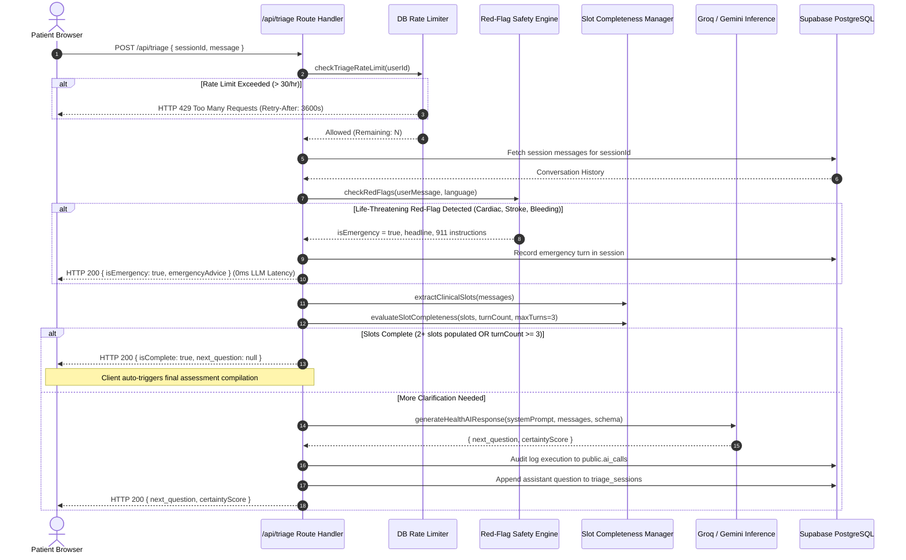

# MedAI System Architecture & Technical Specification

> **Deep-Dive Technical Architecture** · Last Updated: 2026-11-05  
> Defensible 9.5/10 Full-Stack Healthcare Engineering Portfolio Project.

---

## 1. High-Level System Architecture

```mermaid
graph TD
    Client["Client Browser<br/>(React 19 / Next.js App Router)"]
    Proxy["Next.js 16 Network Boundary<br/>(src/proxy.ts / updateSession)"]
    
    subgraph AppRouter ["Next.js 16 Application Server"]
        AuthRoute["/login, /auth/callback"]
        Dashboard["/dashboard<br/>(Paginated Reports & Triage Modal)"]
        ReportViewer["/report/:id<br/>(Next/Image + Dynamic MapLoader)"]
        TriageAPI["POST /api/triage<br/>(Server-Owned Intake Loop)"]
        ClinicsAPI["GET /api/clinics<br/>(1.1km Grid Cache Proxy)"]
    end
    
    subgraph SafetyLayer ["Deterministic Clinical Safety Layer"]
        RedFlags["Deterministic Red-Flags<br/>(en, hi, es, fr - 0ms LLM Latency)"]
        OTCInteractions["Curated OTC Contraindications<br/>(FDA, ACG, AHA Rules)"]
        SlotManager["Clinical Slot Completeness<br/>(Onset, Severity, Symptoms, Turn Cap)"]
        RateLimiter["Database Rate Limiter<br/>(30/hr Triage, 10/day Reports)"]
    end
    
    subgraph AIEngine ["AI Inference Layer (lib/ai.ts)"]
        GroqPrimary["Primary: Groq Cloud API<br/>openai/gpt-oss-120b"]
        GeminiFallback["Fallback & Vision: Google Gemini<br/>gemini-2.5-flash"]
        ZodValidator["Zod Structured Output Schema<br/>+ Single-Turn Correction Retry"]
    end
    
    subgraph DatabaseStorage ["Supabase Cloud Platform"]
        PostgresDB[("PostgreSQL 15+<br/>profiles, reports, triage_sessions, ai_calls<br/>Row Level Security + Immutability Triggers")]
        PrivateStorage["Private Storage Bucket: symptoms<br/>Owner-Scoped Paths + 1-Hour Signed URLs"]
    end
    
    subgraph ExternalServices ["External Geo Infrastructure"]
        OverpassOSM["OpenStreetMap / Overpass API<br/>(Public Healthcare Facility Data)"]
        Nominatim["Nominatim Geocoding API"]
    end

    Client -->|HTTPS| Proxy
    Proxy -->|Guarded Route| Dashboard
    Proxy -->|Guarded Route| ReportViewer
    Proxy -->|Public Route| AuthRoute
    Proxy -->|API Request| TriageAPI
    Proxy -->|Geo Request| ClinicsAPI

    TriageAPI --> RateLimiter
    RateLimiter --> PostgresDB
    TriageAPI --> RedFlags
    TriageAPI --> SlotManager
    TriageAPI --> AIEngine
    
    AIEngine --> GroqPrimary
    GroqPrimary -.->|Timeout / Rate Limit / Vision| GeminiFallback
    AIEngine --> ZodValidator
    AIEngine -->|Audit Telemetry| PostgresDB

    Dashboard --> PostgresDB
    ReportViewer --> PostgresDB
    ReportViewer --> PrivateStorage

    ClinicsAPI -->|Cached Lookup <5ms| ClinicsAPI
    ClinicsAPI -->|Cache Miss Upstream Fetch| OverpassOSM
```

---

## 2. Server-Owned Triage Loop Lifecycle

In legacy architectures, multi-turn clinical triage loops were managed client-side in React state, passing the entire conversation history back and forth in hidden form fields. This created critical security and safety flaws: client tampering with transcripts, uncapped LLM costs, and prompt injection vulnerabilities.

MedAI implements a **Server-Owned Triage State Machine**:

---

## 3. Clinical Slot Completeness Architecture

Rather than terminating questions based on arbitrary client flags, [sessionManager.ts](file:///c:/Users/Lenovo/Desktop/MedAI/web/src/lib/triage/sessionManager.ts) extracts structured clinical slots:
1. **Onset / Timing**: `onsetPatterns` (e.g., "today", "yesterday", "2 days ago", "hours ago").
2. **Severity**: `severityPatterns` (e.g., "8/10", "mild", "severe", "throbbing", "unbearable").
3. **Associated Symptoms**: `symptomKeywords` (e.g., fever, chills, cough, nausea, vomiting, dizziness, rash).
4. **Modifying Factors**: `factorPatterns` (e.g., "better with rest", "worse after eating", "when moving").

### Completion Rules:
- **Turn 1**: If only 1 slot is populated, the server continues questioning.
- **Turn 2+**: If 2 or more core slots are populated, the session evaluates as complete.
- **Turn 3**: Maximum turn cap reached; the loop terminates unconditionally to respect patient time and token budgets.

---

## 4. Multi-Tier AI Provider Routing & Reliability

Located in [lib/ai.ts](file:///c:/Users/Lenovo/Desktop/MedAI/web/src/lib/ai.ts):

1. **Primary Model**: Groq Cloud API with `openai/gpt-oss-120b` (configurable via `GROQ_MODEL_ID`).
2. **Vision Routing**: When a clinical photo is attached:
   - If Groq model is text-only, the router automatically routes directly to Google Gemini vision (`gemini-2.5-flash`).
   - If no Gemini key is provided, the engine throws typed error `AIVisionUnavailableError`.
3. **Transient Backoff Retry**: Transient HTTP `429` (rate limit) or `5xx` (provider downtime) errors trigger an exponential backoff retry (1,000ms delay) before triggering model fallback.
4. **Single-Turn Schema Correction Retry**: If an LLM returns invalid JSON or fails the Zod schema, the engine sends the validation issue summary back to the LLM in a single correction turn.
5. **Observability Audit Logging**: Every invocation records an auditable record in `public.ai_calls` tracking `provider`, `model`, `latency_ms`, `status`, and `error_code`.

---

## 5. Regional Healthcare Facility Caching Proxy

Located in [api/clinics/route.ts](file:///c:/Users/Lenovo/Desktop/MedAI/web/src/app/api/clinics/route.ts):

### Latency Problem
Direct client-side queries to `https://overpass-api.de/api/interpreter` experienced:
- High latency on mobile 4G (2,000ms – 4,000ms).
- Client-side CORS blocks and Overpass rate limits (HTTP 429/504).

### Architectural Solution
1. **Server Route Proxy**: Client queries `GET /api/clinics?lat=...&lon=...`.
2. **Coordinate Grid Rounding**: Coordinates are rounded to 2 decimal places (`Math.round(coord * 100) / 100`), forming ~1.1km grid buckets.
3. **In-Memory TTL Caching**: Results are stored in memory for **1 hour (3,600s)**.
4. **Timeout Enforced**: Upstream Overpass calls use an 8-second `AbortController` timeout.
5. **Dynamic MapLoader Boundary**: [NearbyClinicsMap.tsx](file:///c:/Users/Lenovo/Desktop/MedAI/web/src/app/report/[id]/NearbyClinicsMap.tsx) is dynamically imported via `MapLoader.tsx`, ensuring the 1.09 MB MapLibre GL bundle is never loaded on `/` or `/dashboard`.

---

## 6. Database ER Diagram

```mermaid
erDiagram
    auth_users ||--|| profiles : "has profile (1:1)"
    auth_users ||--o{ reports : "owns assessments (1:N)"
    auth_users ||--o{ triage_sessions : "intake sessions (1:N)"
    auth_users ||--o{ ai_calls : "ai telemetry (1:N)"
    triage_sessions ||--o| reports : "generates (1:1)"
    triage_sessions ||--o{ ai_calls : "tracks calls (1:N)"

    profiles {
        uuid id PK
        int age
        text biological_sex
        text allergies
        text medical_history
        jsonb medications_list
        date last_period_start
        int cycle_length
        boolean is_pregnant
    }

    reports {
        uuid id PK
        uuid user_id FK
        uuid session_id FK
        text symptom_description
        text image_url
        jsonb ai_response
        boolean is_emergency
        boolean is_public
        timestamptz created_at
    }

    triage_sessions {
        uuid id PK
        uuid user_id FK
        text status
        jsonb messages
        jsonb slots
        int turn_count
        timestamptz created_at
    }

    ai_calls {
        uuid id PK
        uuid user_id FK
        uuid session_id FK
        text provider
        text model
        int latency_ms
        text status
        text error_code
        timestamptz created_at
    }
```

